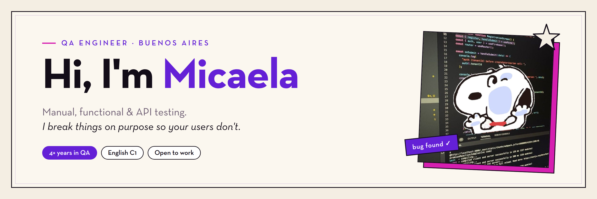

<h3 align="center">Senior QA Engineer · Manual, functional & API testing · Buenos Aires, Argentina</h3>

---

**QA Engineer** based in Buenos Aires, Argentina. 4+ years testing web products for enterprise clients in the US, working in English with distributed teams.

My core is **manual and functional testing**: understanding the product before touching it, designing cases that cover what can actually go wrong, and writing bug reports a developer can act on without asking me twice. I automate when it earns its place; for me, it's not a replacement for thinking.

📂 **[See my manual QA work: test plans, test cases and bug reports](https://github.com/micaelajara/manual-qa-portfolio)**

---

## How I test

The same steps on every project, whether there's a process in place or I'm the one building it.

| Step | What I do | What it leaves behind |
|---|---|---|
| **1. Understand** | Read the ticket or spec, ask the PO or dev until I know what problem the feature solves and for whom | Open questions answered, acceptance criteria clear |
| **2. Explore** | Use the product freely before writing anything, looking at the UI, the network tab and the data | Exploratory notes, first risks spotted |
| **3. Plan** | Decide scope, priorities and what is out, based on business impact | Test plan or checklist |
| **4. Design** | Positive, negative and edge cases, using boundary values and equivalence partitioning where they apply | Test cases with steps and expected results |
| **5. Execute** | Run the cases, record evidence, retest after every fix | Execution status per case, screenshots, videos, API responses |
| **6. Report** | Bugs with environment, steps, actual vs. expected, severity and evidence | Actionable bug reports in Jira, Linear or the team's tool |
| **7. Close** | Regression before release, smoke after deploy, a short summary for the team | Test summary, what's fixed, what's still open |

---

## Selected manual QA work

The full material (all cases, all bug reports, the complete challenge report) is in **[manual-qa-portfolio](https://github.com/micaelajara/manual-qa-portfolio)**.

### 🛒 Óptica Global · B2B wholesale ecommerce (Freelance, 2025 to present)

Independent QA for a live eyewear ecommerce built on Medusa JS. I own the whole process, from deciding what to test to reporting results to the dev team.

- **Test plan of 111 cases across 12 areas:** checkout, payments, user accounts, emails and notifications, volume discounts, referrals, returns and refunds, shipping, catalog, admin panel, Store API and SEO.
- **Balanced coverage:** 42 positive, 43 negative and 26 edge cases. 57 high priority.
- **23 bugs reported with evidence:** 21 confirmed by the dev team (1 critical, 5 high) and 2 closed as expected behavior after review. Each one with environment, steps, actual vs. expected result, severity, linked case and retest notes.
- **Most of it tested by hand or through the real API.** Only 13 cases are automated: the rest needed judgment, real orders or checking data in the admin.
- **3 improvement proposals** for the product team (a product search, a clear "create account" flow, a call to action after checkout).

**Highlight:** the first-purchase discount for customers referred by a lab was **impossible to use**. The referral code could only be entered in the profile, the profile only exists once you have an account, and the account is only created by completing a first purchase, which is the only one that qualifies for the discount. Nobody had noticed because each screen worked fine on its own; the bug was in the chain. After a partial fix I retested with a real order and confirmed the discount still wasn't being applied in the backend.

Another one I'm proud of: a **race condition on stock**. I simulated two customers competing for the last 5 units and confirmed the system rejects the second checkout instead of overselling.

### 🏥 CredentialTracker · Healthcare credentialing app (QA challenge, 2026)

A technical challenge on an app that tracks whether doctors are currently allowed to practice: licenses, DEA registrations, malpractice policies. I tested the UI, the API and the database (read-only SQL).

- **8 findings, ranked by real-world consequence:** 2 critical, 3 high, 3 medium.
- **Critical:** the API returned date of birth and internal HR notes (malpractice claims, background checks) to anyone, with no login at all.
- **Critical:** the dashboard's headline metrics understated real credential expirations by more than half, which is exactly what the product exists to catch.
- Credential dates shown **one day off** on the compliance screen, and an API that answered **HTTP 200 regardless of the outcome**.

Before testing I mapped the domain and the data model, because in a system like this "status says active but the date says expired" is not cosmetic, it's the whole point of the product.

### 🚚 RebelMouse · Enterprise CMS (QA Engineer, 2022 to 2026)

QA and technical support for a SaaS CMS with enterprise clients in the US. QA team in Russia, clients in the US, everything in English.

- **Built the QA process from scratch.** When I joined there was none: I set up test cases, regression before each release, smoke tests after each deploy and the bug flow with development.
- **Penske Truck Rental, the company's biggest client:** end-to-end testing across 5 domains with custom code, covering new features, full redesigns and pre-launch validation.
- **Critical bug in the booking flow**, the feature with the highest business impact. I analyzed the network requests, found the failing endpoint and escalated it with the full impact context. Fixed within hours.
- **Proactive testing** when there were no tickets: I went looking for problems on my own, including validating SEO across entire sites with a Python script and Screaming Frog.
- **Technical support for J.J. Keller:** diagnosing whether an issue was a platform bug, a client configuration or a failing integration (Okta and other third parties).

---

## Automation and technical work

Manual testing tells me what matters. These repos show I can turn that into code when it's worth it.

| Repo | What it shows |
|---|---|
| [optica-global-playwright-tests](https://github.com/micaelajara/optica-global-playwright-tests) | Playwright suite from the Óptica Global project: real OTP login, real orders, SEO checks and API access control |
| [saucedemo-playwright-ci](https://github.com/micaelajara/saucedemo-playwright-ci) | Playwright with Page Object Model and a GitHub Actions pipeline |
| [restful-booker-api-tests](https://github.com/micaelajara/restful-booker-api-tests) | API testing with pytest and requests, documenting real API quirks |
| [juice-shop-checkout-security](https://github.com/micaelajara/juice-shop-checkout-security) | Security tests on a checkout flow (IDOR, business logic), verified by hand first |
| [jenkins-cicd-pipeline](https://github.com/micaelajara/jenkins-cicd-pipeline) | A declarative Jenkins pipeline run against a real local instance |
| [ai-test-case-generator](https://github.com/micaelajara/ai-test-case-generator) | A CLI that drafts test cases with the Claude API, built around a real manual QA template |

---

## Toolbox

🧪 **Testing**

     

🎯 **Techniques**

  

🛠️ **Tools**

       

🤖 **Automation & CI**

      

✨ **AI in my workflow**

 

Claude Code and MCP speed up test design and documentation. I review and confirm everything it produces.

## Currently learning

- **TestingAI** at Academia QA (full scholarship): AI agents, MCP and SQL applied to QA
- **Skills for Work 2026** (Coursera and Santander scholarship)

---

## 🎬 Off the clock: cultural producer

I coordinate the live broadcast of **[Nunca Fuiste al Cine](https://www.nuncafuistealcine.ar)**, a weekly radio show about film. I also built and maintain its website with Claude Code, with Playwright tests, a GitHub Actions pipeline and a domain migration I debugged down to the DNS.

It turns out live radio and release days have a lot in common: a fixed time you can't move, a checklist you trust, and someone who notices what's about to go wrong before it goes on air.
